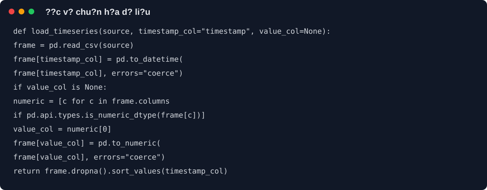
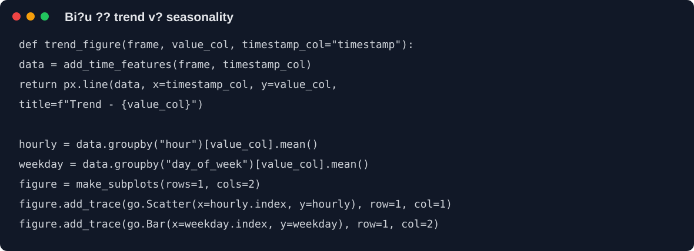
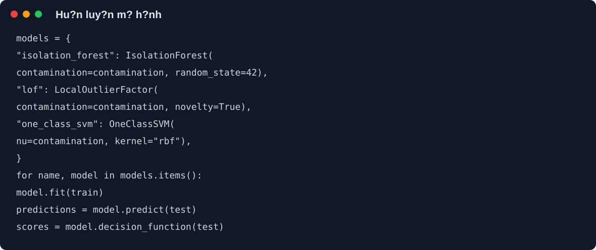
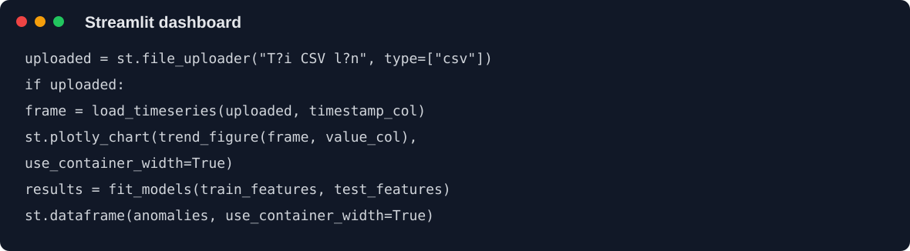

 # BÁO CÁO ĐỒ ÁN

## NGHIÊN CỨU THUẬT TOÁN PHÁT HIỆN BẤT THƯỜNG TRONG CHUỖI THỜI GIAN

### 1. Tóm tắt đề tài

Đề tài nghiên cứu các thuật toán phát hiện điểm bất thường trong chuỗi thời
gian. Dữ liệu thực nghiệm là mức sử dụng CPU của một máy chủ AWS EC2 trong bộ
Numenta Anomaly Benchmark (NAB), ghi nhận 4032 điểm mỗi 5 phút.
Hệ thống tiếp nhận dữ liệu CSV có cột `timestamp` và một cột số, sau đó chuẩn
hóa dữ liệu, tạo đặc trưng thời gian, phân tích xu hướng/mùa vụ và áp dụng các
mô hình phát hiện bất thường.

Sản phẩm gồm hai lớp giao tiếp:

- API FastAPI trả về kết quả JSON để tích hợp với hệ thống khác.
- Giao diện Streamlit cho phép tải CSV, xem biểu đồ tương tác và danh sách điểm
  bất thường.

### 2. Mục tiêu

1. Nghiên cứu bài toán phát hiện bất thường trong chuỗi thời gian.
2. Phát hiện các biến động bất thường của mức sử dụng CPU theo thời gian.
3. Khai thác quy luật chu kỳ theo giờ, ngày trong tuần và ngày cuối tuần.
4. So sánh Isolation Forest, Local Outlier Factor và One-Class SVM.
5. Cung cấp API và giao diện trực quan để hỗ trợ phân tích log CSDL.

### 3. Kiến trúc hệ thống

```text
CSV / NAB dataset
        |
        v
load_timeseries() -> add_time_features()
        |
        +--> trend_figure(), seasonality_figure()
        |
        +--> build_feature_matrix()
                     |
                     v
       Isolation Forest / LOF / One-Class SVM
                     |
                     v
          anomaly points + anomaly score
                /                    \
           FastAPI JSON           Streamlit UI
```

### 4. Chuẩn bị dữ liệu

Hàm `load_timeseries()` đọc đường dẫn CSV, file upload hoặc DataFrame. Hàm kiểm
tra cột thời gian, chuyển timestamp sang `datetime`, ép kiểu cột giá trị về số,
loại bỏ dòng lỗi và sắp xếp theo thời gian.



File [ec2_cpu_utilization.csv](./DACN/ml-anomaly-detection/data/ec2_cpu_utilization.csv)
có 4032 điểm đo CPU mỗi 5 phút. Hai điểm bất thường được gắn nhãn theo NAB:
`2014-02-26 22:05:00` và `2014-02-27 17:15:00`.

### 5. Kỹ thuật đặc trưng

Từ timestamp, hệ thống trích xuất `hour`, `day_of_week`, `is_weekend`,
`day_of_month`, `month` cùng các đặc trưng chu kỳ `hour_sin`, `hour_cos`,
`dow_sin`, `dow_cos`.

Mã hóa sin/cos giúp giờ 23 và giờ 0 có vị trí gần nhau về mặt toán học, phù hợp
hơn so với việc coi giờ là số nguyên tuyến tính.


Ma trận đầu vào mô hình trong thí nghiệm NAB gồm `value`; các đặc trưng lịch
thời gian được cung cấp thêm trong pipeline mở rộng.

### 6. Phân tích khám phá dữ liệu

Hệ thống dùng Plotly để tạo biểu đồ tương tác:

- Biểu đồ trend thể hiện giá trị theo timestamp.
- Biểu đồ seasonality gồm trung bình theo giờ và theo ngày trong tuần.
- Người dùng có thể phóng to, thu nhỏ và xem giá trị tại từng điểm.



Phân tích mùa vụ giúp phân biệt biến động CPU lặp lại theo chu kỳ với một điểm
bất thường thực sự.

### 7. Các mô hình phát hiện bất thường

Isolation Forest cô lập các điểm dữ liệu bằng nhiều cây ngẫu nhiên. LOF so sánh
mật độ cục bộ của một điểm với các điểm lân cận. One-Class SVM học biên bao
quanh phần lớn dữ liệu bình thường.

Theo quy ước scikit-learn, `1` là bình thường và `-1` là bất thường.



### 8. Đánh giá và tinh chỉnh

Do dữ liệu bất thường thường mất cân bằng, hệ thống sử dụng:

- **Precision**: tỷ lệ cảnh báo đúng.
- **Recall**: tỷ lệ anomaly thực tế được phát hiện.
- **F1-score**: trung bình điều hòa giữa precision và recall.

Hàm `tune_model()` thử các tổ hợp `n_estimators`, `max_samples` cho Isolation
Forest và `n_neighbors`, `leaf_size` cho LOF, sau đó chọn F1-score cao nhất.


### 9. API Backend

Endpoint `POST /detect` nhận CSV dạng multipart, chia 70% train và 30% test theo
thứ tự thời gian, chạy ba mô hình và trả về danh sách anomaly dưới dạng JSON.
Endpoint `GET /health` trả về `{"status": "ok"}`.


```powershell
cd DACN\ml-anomaly-detection
uvicorn backend.api:app --reload
```

### 10. Giao diện Streamlit

Người dùng chọn file CSV, cột timestamp, cột giá trị và tỷ lệ contamination.
Giao diện hiển thị biểu đồ Plotly cùng bảng kết quả của từng mô hình.



```powershell
cd DACN\ml-anomaly-detection
streamlit run frontend/app.py
```

### 11. Kết quả kiểm thử

| Hạng mục | Kết quả |
|---|---|
| Biên dịch các module Python | Đạt |
| Tạo đặc trưng thời gian | Đạt |
| Chạy Isolation Forest, LOF, One-Class SVM | Đạt |
| API handler với CSV mẫu | Đạt |
| CSV mẫu | 72 dòng, 2 anomaly gắn nhãn |

### 12. Hạn chế và hướng phát triển

- Tập test hiện tại nhỏ, cần đánh giá thêm trên nhiều bộ dữ liệu NAB.
- Có thể bổ sung Autoencoder, Prophet hoặc cảnh báo theo thời gian thực.
- Nên thêm xác thực file, giới hạn kích thước upload và lưu lịch sử dự đoán.

### 13. Kết luận

Hệ thống đã xây dựng được pipeline nghiên cứu trên dữ liệu NAB: chuẩn hóa chuỗi
CPU, gắn nhãn theo timestamp chuẩn, phân tích EDA, so sánh MAD/Isolation Forest/
LOF/One-Class SVM, đánh giá bằng Precision/Recall/F1 và cung cấp API cùng giao
diện web.